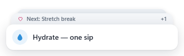
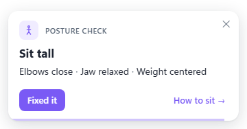
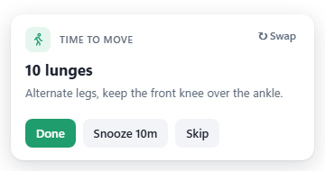
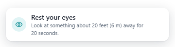
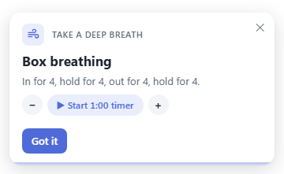
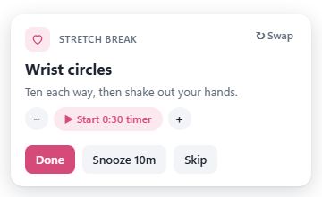

# Reminders

A quiet Windows tray app that reminds you to **move**, **drink water** and **sit well**, plus anything else you add yourself. Reminders appear in the corner of your screen, never take keyboard focus, and get out of your way.



- **Move** every hour: a suggested exercise (walk, squats, stretches…), with a countdown timer for timed ones.
- **Water** every 20 minutes: a slim, silent card that fades by itself.
- **Posture** every 30 minutes: three quick cues like "Hips back · Shoulders down · Chin tucked", plus a guide to sitting well.
- **Your own reminders**: rest your eyes, take a breath, stretch, take your medicine. Anything, on any schedule, optionally rotating through a list.

It runs entirely on your computer: no account, no internet connection, no tracking.

## Install

1. Download **`Reminders-Setup-<version>.exe`** from the [latest release](https://github.com/zharnite/reminders/releases/latest) (Windows 10 or 11, 64-bit), or build it yourself (see [Build from source](#build-from-source)).
2. Run it. Windows may show **"Windows protected your PC"** because the installer isn't code-signed: click **More info → Run anyway**.
3. Reminders installs for your user account only (no admin needed), starts right away, and appears as a green drop in the system tray near the clock. Click the **^** arrow there if you don't see it.

It starts with Windows by default; turn that off in **Reminders → General**. To uninstall, use **Windows Settings → Apps → Installed apps → Reminders**.

## Using it

**Click the tray icon** to open the main window. **Right-click it** for a quick menu: what's coming up, Remind me now, Pause, Mute sounds and Quit.

### The reminders

Every reminder uses one of three styles, from barely there to hard to miss:

| Style | Looks like | Sound | Goes away |
|---|---|---|---|
| **Slim card** (Water) |  | None | Click it, or it fades after 8 s (hover to keep it). Can be set to stay until clicked |
| **Fading card** (Posture) |  | None | Fades after 15 s by default (hover to keep it), or click the button |
| **Waiting card** (Move) |  | Soft chime (optional) | Only when you click Done, Snooze 10m or Skip |

On the Move card, **↻ Swap** picks a different exercise, and timed exercises have a **Start timer** button (− and + change the length, and it's remembered).

**When several are due**, they stack: the next one peeks out behind the card on screen ("Next: Posture"), and comes forward when you answer the front one. Each reminder is its own card, so answering one never clears another, and a reminder is never in the stack twice.

### The main window

- **Home:** countdowns, **Remind me now**, **Pause** (30 min, 1 hour, 2 hours, until tomorrow, or your own length) and **Mute all sounds**.
- **Reminders:** switch each reminder on or off, set how often, choose whether the water and posture cards fade, and manage **Your reminders**. **General** has **Appearance** (System, Light or Dark) and **Start when Windows starts**.
- **Exercises:** choose which exercises Move suggests, edit them, give them timers, or add your own.
- **When to remind:** pause while you're away from the computer, only remind during your working hours (09:00 to 18:00, Monday to Friday by default), and stay quiet during fullscreen apps, video calls and presentations. Each can be turned off.
- **Guides:** **Notification styles** shows each style with a Preview button; **Posture guide** explains how to sit well, with a 10-second reset and a one-time desk setup checklist.

### Your own reminders

In **Reminders → Your reminders**, click **+ Add reminder**. Give it a name, an optional message, how often, a style and an icon, then **Preview** it before saving. One-click ideas fill in the form for you: *Rest your eyes*, *Take a deep breath*, *Stretch break* and *Take your medicine*.

Fading and waiting cards can **rotate through a list**: each time the reminder comes up, it shows the next item, with ↻ Swap and an optional timer, just like Move's exercises.

  

## Light on resources

It's built to sit in the tray all day: about 56 to 70 MB of memory and under 20 ms of CPU per minute while idle. Windows are created when they're shown and closed when you're done with them.

## Your data

Settings are stored in `%APPDATA%\Reminders\settings.json` on your computer. Nothing is sent anywhere.

## Build from source

You need [Node.js](https://nodejs.org) 20 or newer on Windows.

```powershell
git clone https://github.com/zharnite/reminders.git
cd reminders
npm install
npm start          # run it
npm run fast       # try it with 1 minute = 1 second (separate settings, yellow banner)
npm test           # unit tests
npm run dist       # build the installer into dist\
```

Want to change how it works? [AGENTS.md](AGENTS.md) explains how the app is put together, for people and coding agents alike.

## License

[MIT](LICENSE)
